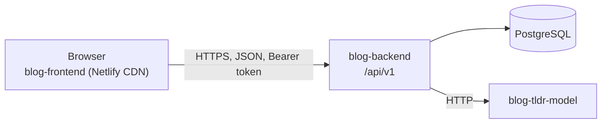

# blog-frontend

[](https://github.com/E-L-R/blog-frontend/actions/workflows/ci.yml)
[](https://github.com/E-L-R/blog-frontend/actions/workflows/codeql.yml)

The React frontend of a technical blog whose posts get **TL;DRs from a language model built from
scratch**. Three repositories, one product:

| Repository                                                  | What it is                                                              |
| ----------------------------------------------------------- | ----------------------------------------------------------------------- |
| **blog-frontend** (this one)                                | React single-page app on Netlify                                        |
| [blog-backend](https://github.com/E-L-R/blog-backend)       | Spring Boot REST API: posts, users, comments, TL;DR orchestration       |
| [blog-tldr-model](https://github.com/E-L-R/blog-tldr-model) | GPT-2 implemented in PyTorch, fine-tuned to summarize, served over HTTP |

The browser only talks to blog-backend. The backend calls the model and stores its summaries; the
frontend shows them, labeled as AI-generated.



## Features

- **Readers**: latest posts, full-text search, tags, author profiles, comments, and TL;DRs (polling while
  the model writes one)
- **Authors**: Markdown editor with preview, drafts, publish/unpublish, delete, write or regenerate the
  TL;DR, a dashboard of their posts
- **Accounts**: register, sign in, profile, password change; sessions survive reloads and are shared
  safely between tabs
- **Demo mode**: without a backend URL the app runs on a mock API (in a service worker) that follows
  the backend's contract, with a visible "Demo mode" banner. Sign in as `demo` / `demo-password`.

## Quick start

Requires Node.js 24 or newer.

```bash
npm ci
npm run dev
```

Open http://localhost:5173. Without configuration this is demo mode: no backend needed.

To use a running blog-backend instead, create `.env.local` (see `.env.example`):

```bash
VITE_API_BASE_URL=http://localhost:8080
```

The backend must allow the dev server's origin in CORS (`BLOG_CORS_ALLOWED_ORIGINS`, which includes
`http://localhost:5173` by default).

## Scripts

| Command                           | What it does                                                                                   |
| --------------------------------- | ---------------------------------------------------------------------------------------------- |
| `npm run dev`                     | Development server with hot reload                                                             |
| `npm run build`                   | Type-check and build to `dist/` (with Netlify's `_headers` and `_redirects`)                   |
| `npm run preview`                 | Serve `dist/` with the production security headers                                             |
| `npm test`                        | Unit and integration tests (Vitest, Testing Library, MSW)                                      |
| `npm run test:coverage`           | The same, with the coverage gate                                                               |
| `npm run e2e`                     | End-to-end tests in Chromium (Playwright); run `npm run build` and `npm run e2e:install` first |
| `npm run lint` / `npm run format` | ESLint (type-aware, accessibility, React rules) / Prettier                                     |
| `npm run verify`                  | Everything CI checks, except the end-to-end tests                                              |

## Architecture

```
src/
  api/        HTTP client, endpoint functions, zod schemas (runtime-validated responses), errors
  auth/       session (tokens), AuthProvider, route guard, permission helpers
  app/        routes, layout, error pages, query client
  features/   pages by feature: posts, comments, editor, dashboard, account, tags, users, tldr
  components/ shared UI (buttons, fields, dialogs, alerts…)
  lib/        sanitizing, Markdown, formatting
  mocks/      the demo/test API (MSW handlers, in-memory database, seed content)
contract/     blog-backend's OpenAPI document, checked by src/api/contract.test.ts
build/        security headers and the Netlify build plugin
e2e/          Playwright tests
```

- **Server state** lives in TanStack Query (caching, retries for transient errors only, polling for
  TL;DRs). There is no global client state beyond the session.
- **Every response is validated** with zod. A backend change surfaces as one clear error instead of
  `undefined` deep inside a component, and `contract.test.ts` checks both directions against the
  backend's OpenAPI document.
- **Errors** are blog-backend's problem details: the UI branches on the stable `type`, shows field
  errors next to their inputs, explains rate limits (`Retry-After`), and shows the `X-Trace-Id` as a
  support reference for server errors.
- **Code splitting**: the editor, dashboard and settings load on demand; readers never download the
  Markdown renderer. The demo's mock API is a separate chunk that real-API builds don't contain.

## Security

- **Tokens**: the access token (15 minutes) lives only in memory. The refresh token (rotating, 7 days)
  is in `localStorage` so reloads and new tabs stay signed in. Because blog-backend treats a reused
  refresh token as theft and ends the session, refreshes are single-flight in a tab, serialized across
  tabs with the Web Locks API, and new access tokens are shared over a `BroadcastChannel`. Moving the
  refresh token into an `httpOnly` cookie is planned in the backend; the session module is the only
  code that would change.
- **XSS**: post HTML is sanitized by the backend and again here (DOMPurify) before it is injected;
  comments are plain text. A strict Content-Security-Policy (`script-src 'self'`, no inline scripts
  or styles, `connect-src` limited to the API) is sent with every page. The end-to-end tests fail on
  any CSP violation.
- **Other headers**: `X-Frame-Options: DENY`, `nosniff`, `Referrer-Policy`, `Permissions-Policy`,
  HSTS; demo builds and previews are `noindex`.
- **No open redirects**: the `next` parameter of the sign-in page only accepts paths on this site.
- **Supply chain**: exact dependency versions and a lockfile, npm install scripts blocked by default,
  GitHub Actions pinned to commit SHAs, Dependabot with a 7-day cooldown, CodeQL and dependency review.

## Testing

- **Unit and integration** (Vitest + Testing Library): the whole app is rendered against the mock API,
  and driven by roles and labels like a user would. The mock API implements the backend's rules:
  rotation and reuse detection, optimistic locking, the moderation matrix, sort allow-lists,
  background TL;DRs.
- **Contract**: response schemas and every request the client sends are checked against
  `contract/openapi.json`.
- **End-to-end** (Playwright, Chromium): reader and author journeys on the production build, axe-core
  accessibility scans (WCAG 2.1 AA) of every page, a phone-sized viewport, CSP violations and
  uncaught errors fail every test.

## Deployment (Netlify, free plan)

Netlify's free plan has **300 credits per month**, and running out **pauses every site** until the
next month. A production deploy costs 15 credits; deploy previews cost none. So this repository uses
GitHub Actions instead of Netlify's own builds:

- **Every pull request**: all checks run, then the build is deployed to a free preview URL
  (`https://pr-<number>--<site>.netlify.app`, linked from the pull request). Dependabot's pull
  requests get the checks but no preview: they never see the deploy token.
- **Production**: only when a release tag (`v1.2.3`) is pushed, or when the CI workflow is run
  manually with "deploy" checked. Merging to `main` costs nothing.
- It is a static single-page app: no Netlify Functions, so no compute credits.
- The site is connected to this repository, but `netlify.toml` (`ignore = "exit 0"`) makes Netlify skip its own Git builds: otherwise every merge to `main` would be an untested production deploy costing credits.

### One-time setup

1. Create the site (Netlify UI → _Add new project_ → _Deploy manually_, or `npx netlify-cli sites:create`).
   Note its **Site ID** (_Project configuration → General_).
2. Create a personal access token (_User settings → Applications → Personal access tokens_).
3. Add them to this repository:
   ```bash
   gh variable set NETLIFY_SITE_ID --body "<site id>"
   gh secret set NETLIFY_AUTH_TOKEN
   ```
4. Optional, once blog-backend is deployed: `gh variable set VITE_API_BASE_URL --body "https://api.example.com"`.
   Until then, deployments run in demo mode.
5. Optional: protect the `production` environment (_Settings → Environments_) with a required reviewer.

Until `NETLIFY_SITE_ID` exists, the deploy jobs are skipped and CI stays green.

### Releasing

```bash
npm version minor --no-git-tag-version   # or patch / major
git commit -am "chore(release): v0.2.0"  # via a pull request, like every change
# after merging:
git switch main && git pull --ff-only
git tag -a v0.2.0 -m "blog-frontend 0.2.0" && git push origin v0.2.0
```

## Contract with blog-backend

The frontend is built against the backend's planned API (`contract/openapi.json`, see
[contract/README.md](contract/README.md)). Where the plan needs changes for a production frontend,
there are issues in blog-backend (labeled `area:frontend`).

## License

[MIT](LICENSE.md)
